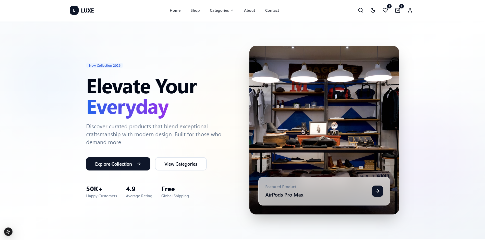
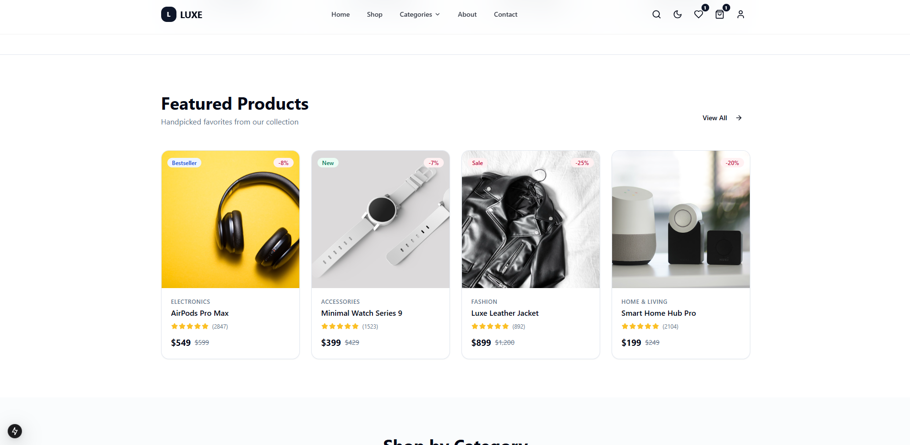
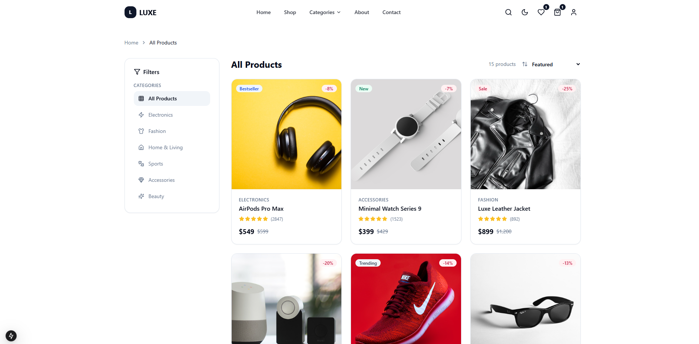
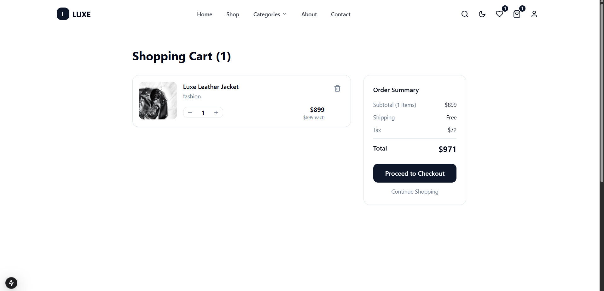
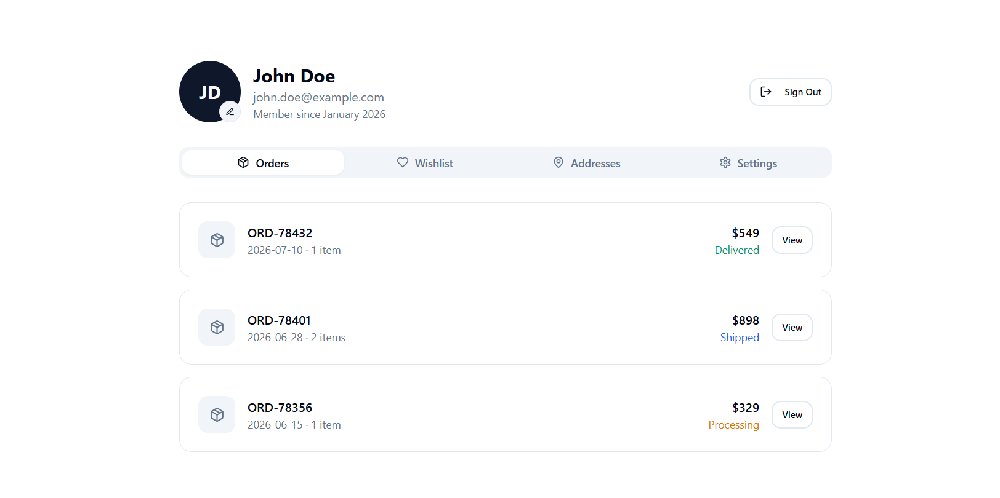

# 🛍️ Luxe Store — Premium E-Commerce Platform




A modern premium full-stack e-commerce platform built with **Next.js, TypeScript, Tailwind CSS, MongoDB, and modern web technologies**.

Designed with inspiration from **Apple, Nike, Stripe, Linear, and Vercel** to provide a luxury shopping experience.

---

## ✨ Features

### 🛒 Shopping Experience

- ✅ Premium product showcase
- ✅ Product details pages
- ✅ Product search
- ✅ Category filtering
- ✅ Price filtering
- ✅ Shopping cart
- ✅ Wishlist
- ✅ Checkout flow
- ✅ Recently viewed products
- ✅ Related products
- ✅ Responsive mobile design


### 👤 User Features

- ✅ User registration
- ✅ User login
- ✅ User profile
- ✅ Order history
- ✅ Product reviews
- ✅ Secure authentication


### 🛠️ Admin Features

- ✅ Admin dashboard
- ✅ Product management
- ✅ Category management
- ✅ Order management
- ✅ User management
- ✅ Sales analytics


### 🎨 UI/UX Features

- ✨ Premium luxury design
- ✨ Dark / Light mode
- ✨ Glassmorphism effects
- ✨ Smooth animations
- ✨ Modern gradients
- ✨ Responsive layout
- ✨ Loading skeletons
- ✨ Toast notifications


---

# 📸 Screenshots

## 🏠 Home Page




## 🛍️ Shop Page




## 📦 Product Details


## 🛒 Cart Page




## 👤 Profile Page




---

# 🚀 Tech Stack


## Frontend

<p>

</p>


## Backend

<p>

</p>


## Tools

<p>

</p>


Additional technologies:

- ⚡ Next.js App Router
- 🎭 Framer Motion
- 🎨 Shadcn/UI
- 🔥 Radix UI
- 🧩 Lucide React
- 📦 Mongoose
- 🔐 NextAuth
- 🛡️ Zod Validation


---

# 📂 Project Structure


```
luxe-store/

├── app/
│   ├── (shop)/
│   ├── (auth)/
│   ├── api/
│   ├── dashboard/
│   └── globals.css


├── components/

│   ├── ui/
│   ├── layout/
│   ├── product/
│   ├── cart/
│   ├── sections/
│   └── filters/


├── models/

│   ├── User.ts
│   ├── Product.ts
│   ├── Order.ts


├── lib/

│   ├── mongodb.ts
│   ├── utils.ts


├── public/

│   ├── images/
│   └── screenshots/


└── package.json
```


---

# 🌍 Pages


## Main Pages

- 🏠 Home
- 🛒 Shop
- 📦 Product Details
- 🏷️ Categories
- ❤️ Wishlist
- 🛍️ Cart
- 💳 Checkout
- 👤 Profile
- 📞 Contact
- ℹ️ About


## Authentication

- 🔐 Login
- 📝 Register
- 🚪 Logout


## Admin

- 📊 Dashboard
- 📦 Products
- 👥 Users
- 🧾 Orders


---

# ⚙️ Installation


Clone repository:

```bash
git clone https://github.com/yourusername/luxe-store-ecommerce.git
```


Install packages:

```bash
npm install
```


Run development server:

```bash
npm run dev
```


Open:

```
http://localhost:3000
```


---

# 🔐 Environment Variables


Create:

```
.env.local
```


Add:


```env
MONGODB_URI=

NEXTAUTH_SECRET=

NEXTAUTH_URL=

JWT_SECRET=
```


---

# 📱 Responsive Design

The application works perfectly on:

- 📱 Mobile
- 💻 Laptop
- 🖥️ Desktop
- 📟 Tablet


---

# 👨‍💻 Developer

Built with ❤️ using modern web technologies.

⭐ If you like this project, consider giving it a star on GitHub.